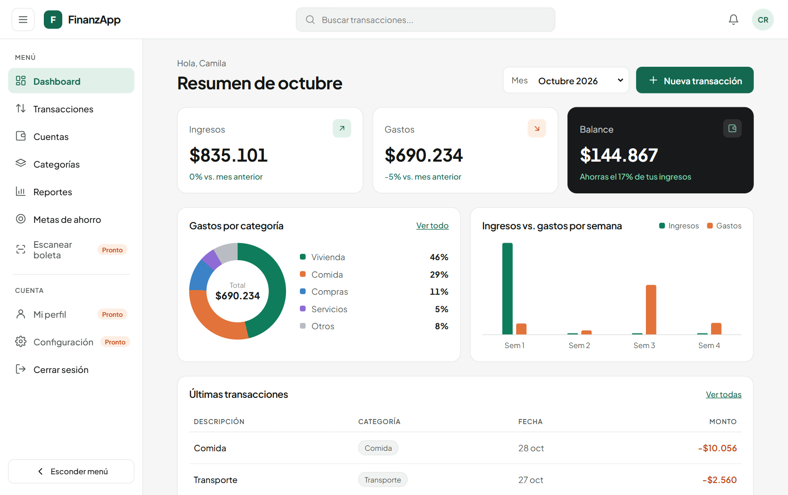
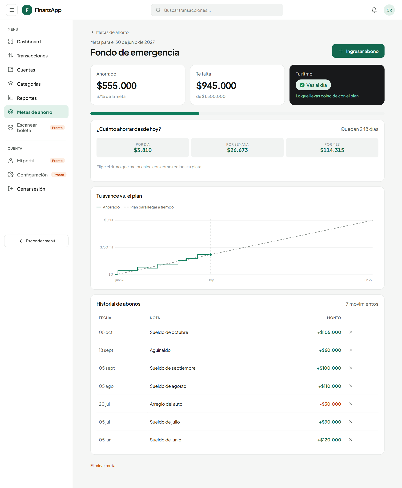
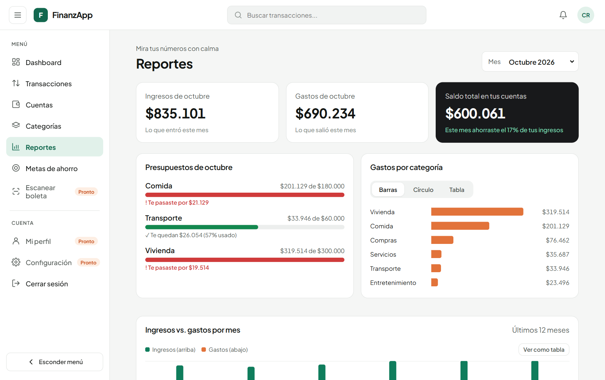
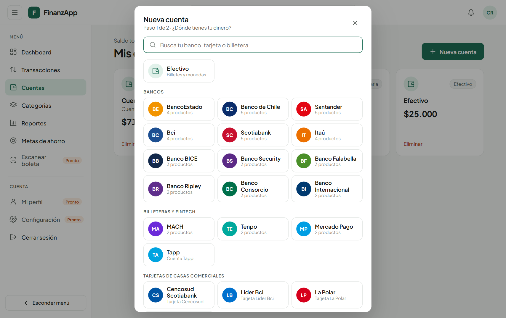
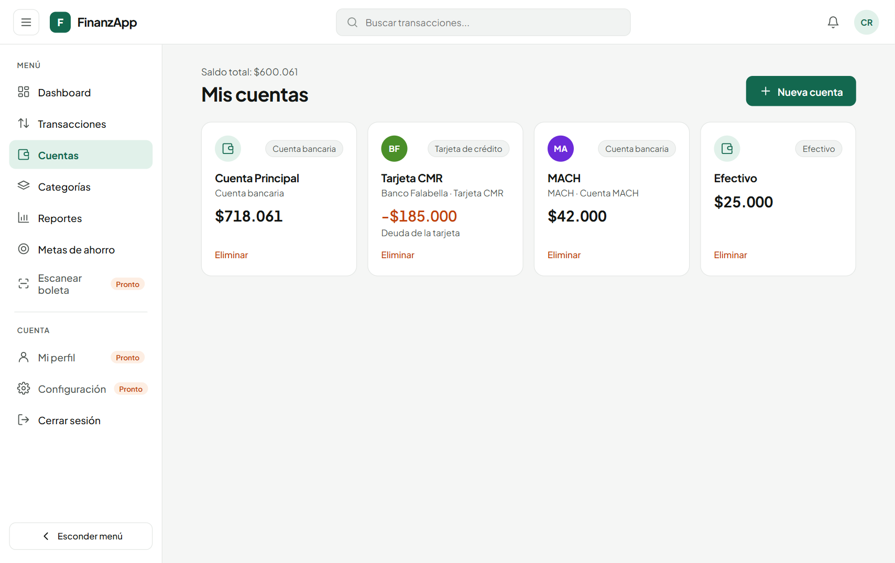
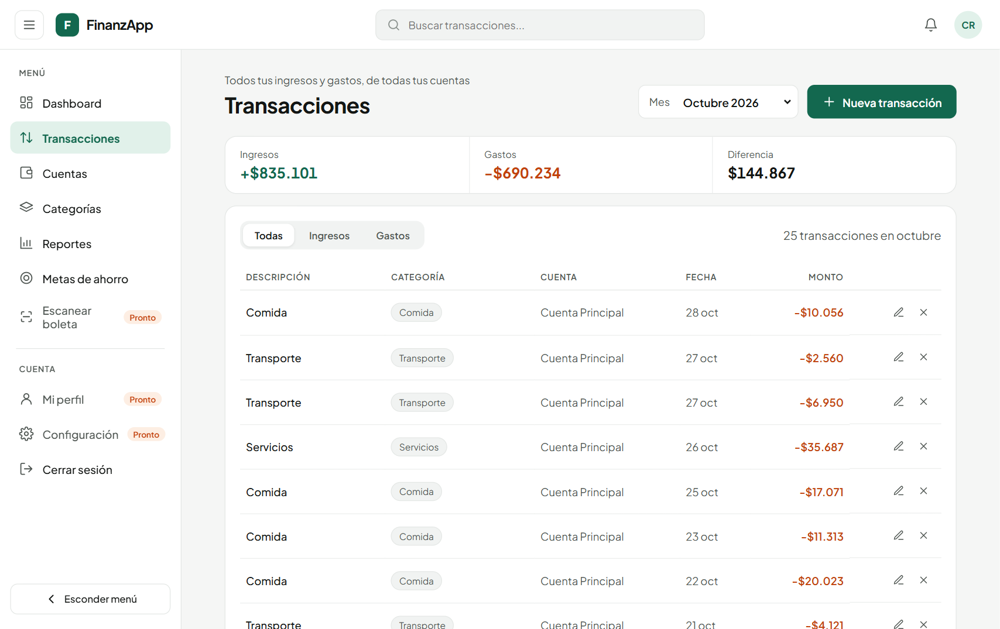
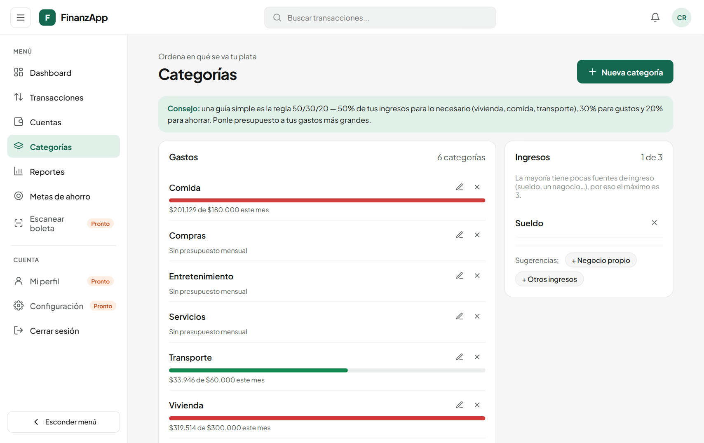
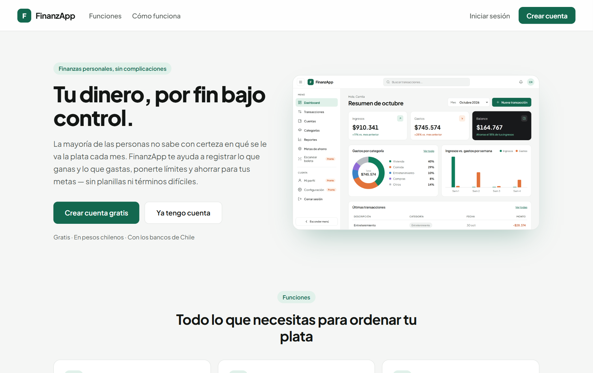
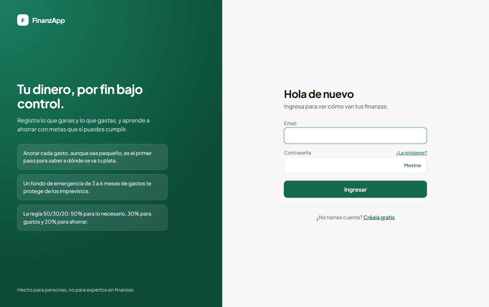
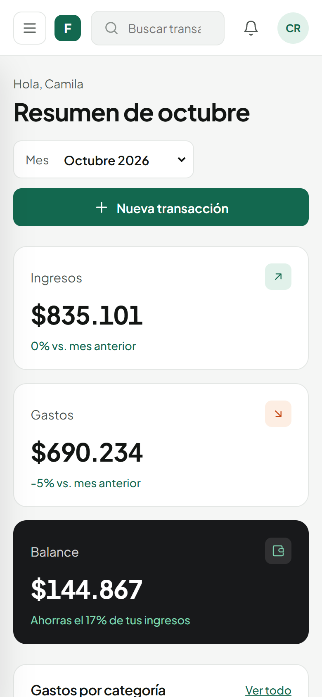

# FinanzApp

[](https://github.com/LuisCorts14/FinanzApp/actions/workflows/ci.yml)

**Finanzas personales para personas que nunca han llevado sus cuentas.** FinanzApp ayuda a registrar ingresos y gastos, ponerse límites por categoría y ahorrar para metas con un plan concreto, sin planillas ni jerga financiera. Pensada para Chile: montos en pesos chilenos y un catálogo de bancos, tarjetas y billeteras locales.



## ¿Por qué?

Mucha gente no sabe con certeza a dónde se le va el dinero cada mes. Las apps de finanzas suelen asumir que el usuario ya sabe qué es una "cuenta vista", cómo armar un presupuesto o cuánto debería ahorrar. FinanzApp parte desde cero: usa lenguaje simple, muestra si vas bien o mal con colores e íconos, y va dejando consejos (regla 50/30/20, fondo de emergencia, "págate primero") en el camino.

## Funcionalidades

- **Dashboard del mes:** ingresos, gastos y balance con variación respecto al mes anterior, porcentaje de ahorro, gastos por categoría, ingresos vs. gastos por semana y últimas transacciones.
- **Cuentas con bancos de Chile:** al crear una cuenta eliges tu institución (BancoEstado, Banco de Chile, Santander, MACH, Tenpo, CMR...) y solo ves sus productos (CuentaRUT, Cuenta Corriente, tarjeta de crédito...). El tipo y la moneda de la cuenta salen del producto, y cada cuenta se puede editar después para cambiar su institución o producto.
- **Tarjetas de crédito con cupo:** la deuda se muestra en negativo, junto al cupo usado y disponible y un consejo según el uso (mantenerse bajo el 30%, alerta desde el 80%).
- **Escanear boleta con IA:** tomas una foto y Claude lee el comercio, la fecha, el total y cada producto, asignándolo a una de tus categorías. La app agrupa los montos por categoría y te propone los gastos (p. ej. "Comida $3.280" y "Hogar $12.180" de una misma boleta del supermercado); tú revisas y confirmas antes de guardar. La foto no se guarda y hay un límite diario de escaneos por persona.
- **Transacciones:** registro, edición y eliminación con filtros por mes y tipo, y un buscador por descripción o categoría. El saldo de cada cuenta se actualiza solo.
- **Transferencias entre cuentas:** pagar la tarjeta desde la cuenta corriente, mandar plata a la cuenta de ahorro o sacar efectivo. Mueven los saldos de ambas cuentas pero no cuentan como ingreso ni como gasto, así los reportes no se inflan. Soportan cuentas con distinta moneda, y cada tarjeta tiene un atajo "Pagar tarjeta".
- **Categorías y presupuestos:** cada categoría de gasto puede tener un límite mensual, con una barra que pasa de verde a amarillo (80%) y rojo (excedido).
- **Metas de ahorro:** abonos y retiros con historial, cuánto apartar por día, semana o mes, un indicador de ritmo ("vas al día", "vas atrasado $X") y un gráfico del ahorro real contra el plan.
- **Reportes:** tasa de ahorro, estado de los presupuestos, gastos por categoría (barras, círculo o tabla) e ingresos vs. gastos de los últimos 12 meses.
- **Cuentas de usuario:** registro e inicio de sesión con JWT y recuperación de contraseña por correo. Cada persona ve solo sus datos.
- **Mi perfil:** editar nombre y email (el email pide la contraseña actual), cambiar la contraseña cerrando las sesiones de otros dispositivos, ver un resumen de tus datos y eliminar la cuenta con todo lo asociado.
- **Multimoneda:** cuentas en USD u otras monedas, convertidas a CLP con tasas de cambio en caché.

## Capturas

| Metas de ahorro | Reportes |
|---|---|
|  |  |

| Nueva cuenta (catálogo de bancos) | Cuentas |
|---|---|
|  |  |

| Transacciones | Categorías y presupuestos |
|---|---|
|  |  |

| Landing | Inicio de sesión | Móvil |
|---|---|---|
|  |  |  |

## Stack

**Backend:** Python 3.12 · FastAPI · SQLAlchemy 2.0 · Pydantic v2 · PostgreSQL 16 · Alembic · JWT (PyJWT + bcrypt) · Resend (correos) · Claude API (lectura de boletas)
**Frontend:** React 19 · TypeScript · Vite · React Router · Axios. Sin librerías de UI ni de gráficos: los componentes y gráficos están hechos a mano con CSS y SVG.
**Infra local:** Docker Compose (Postgres)

## Arquitectura

```
finanzApp/
├── app/
│   ├── api/v1/endpoints/   # auth, accounts, catalog, categories, transactions, transfers, stats, savings_goals
│   ├── core/               # config, seguridad, tasas de cambio, catálogo de instituciones, correos
│   ├── db/                 # engine y sesión
│   ├── models/             # User, Account, Category, Transaction, SavingsGoal, SavingsContribution...
│   └── schemas/            # validación de entrada/salida con Pydantic
├── alembic/versions/       # migraciones (incluye migraciones de datos)
├── scripts/seed_demo_data.py
├── frontend/src/
│   ├── api/                # cliente HTTP por recurso
│   ├── components/         # layout, modales, tablas, gráficos (SVG/CSS)
│   ├── context/            # sesión (AuthContext)
│   ├── pages/              # Dashboard, Transacciones, Cuentas, Categorías, Reportes, Metas, auth, landing
│   └── utils/              # formato CLP, fechas, cálculo de ritmo de ahorro
└── docker-compose.yml
```

La documentación interactiva de la API (Swagger) queda en `http://localhost:8002/docs`.

## Cómo correrlo localmente

**Requisitos:** Python 3.12+, Node 20+ y Docker.

**1. Base de datos**
```bash
cp .env.example .env      # ajusta SECRET_KEY y, si quieres correos reales, RESEND_API_KEY
docker compose up -d
```

**2. Backend** (puerto 8002)
```bash
python -m venv venv
.\venv\Scripts\activate    # Windows · en Linux/Mac: source venv/bin/activate
pip install -r requirements.txt
alembic upgrade head
uvicorn main:app --port 8002
```

**3. Frontend**
```bash
cd frontend
cp .env.example .env
npm install
npm run dev
```

Abre `http://localhost:5173`.

**Datos de demostración (opcional):** crea una cuenta desde la app y luego carga 5 meses de movimientos de ejemplo para ese usuario:
```bash
python scripts/seed_demo_data.py tu-email@ejemplo.com
```

Si no configuras `RESEND_API_KEY`, el link para recuperar la contraseña se imprime en la consola del backend. Para **escanear boletas**, agrega tu `ANTHROPIC_API_KEY` (de [console.anthropic.com](https://console.anthropic.com)) al `.env`; sin ella, esa sección aparece como no disponible y el resto de la app funciona igual.

## Tests

El backend tiene una suite de **pytest** (61 tests) que recorre la API de punta a punta con `TestClient`: autenticación y recuperación de contraseña, saldos que siguen a cada movimiento, catálogo de bancos, transferencias (incluyendo distinta moneda), escaneo de boletas (con la llamada a Claude simulada), saldos correctos bajo solicitudes concurrentes, estadísticas, presupuestos, metas de ahorro y aislamiento de datos entre usuarios.

```bash
pip install -r requirements-dev.txt
pytest
```

Los tests usan su propia base de datos `finanzapp_test` (se crea sola en el mismo Postgres de Docker) y se niegan a correr contra una base cuyo nombre no termine en `_test`, así nunca tocan los datos de desarrollo. Las tasas de cambio y el envío de correos se reemplazan por versiones falsas, sin llamadas a internet.

En cada push, **GitHub Actions** corre las migraciones sobre una base vacía, la suite de pytest, el lint y el build del frontend.

## Decisiones de diseño

- **El saldo se calcula, no se edita.** El saldo de una cuenta solo cambia a través de sus movimientos (crear, editar o borrar), así nunca se desincroniza del historial.
- **La categoría define si es ingreso o gasto.** La transacción no tiene un campo de tipo propio, así que no se puede, por ejemplo, registrar "Comida" como un ingreso por error.
- **La moneda de una cuenta con movimientos no se cambia.** Al editar, el backend rechaza un cambio de producto que implique otra moneda si la cuenta ya tiene transacciones, porque sus montos quedarían mal interpretados.
- **Las transferencias son una entidad propia.** No se modelan como un gasto más un ingreso con categoría, sino en su propia tabla. Así nunca aparecen en reportes ni presupuestos, y borrar una revierte los saldos de ambas cuentas de una sola vez.
- **La IA propone, la persona decide.** El escaneo de boletas usa salida estructurada (JSON Schema) y el backend no confía en lo que devuelve el modelo: descarta ids de categorías que no son de esa persona y fechas inválidas. Nada se guarda sin que la persona revise y confirme.
- **Cambiar la contraseña invalida los tokens anteriores.** Los JWT llevan una versión que se incrementa al cambiar o recuperar la contraseña; un token viejo deja de servir aunque no haya expirado.
- **Saldos atómicos.** El saldo se ajusta con `UPDATE ... SET balance = balance + x` en la base de datos, no leyendo y escribiendo desde Python, para no perder actualizaciones cuando llegan varias solicitudes a la vez (un test de concurrencia lo cubre).
- **El catálogo manda.** Si una cuenta se crea desde un producto del catálogo, el backend fija el tipo y la moneda según el producto, aunque el cliente envíe otros valores. Es una lista mantenida a mano, porque no existe una API pública con los productos bancarios de Chile.
- **Máximo 3 categorías de ingreso.** Es una decisión de producto: la mayoría de las personas tiene una o dos fuentes de ingreso, y limitar las categorías evita que se desordenen. Los gastos no tienen límite.
- **El plan de ahorro parte desde lo que ya tenías.** El ritmo de una meta se mide contra una línea que va desde lo ahorrado al crearla hasta el objetivo. Así una meta nueva con plata ya guardada aparece "al día" y no "adelantada" por todo ese monto.
- **Color con significado y accesible.** Verde, amarillo y rojo siempre van acompañados de un ícono o texto. Los colores de los gráficos se validaron para contraste y daltonismo.
- **Si falla la API de tasas de cambio, la app sigue funcionando.** Usa las últimas tasas en caché (6 h) en vez de romperse.

## Próximos pasos

- Tests de componentes en el frontend
- Deploy público con una cuenta demo
- Configuración, notificaciones y consejos personalizados en el Dashboard

## Autor

Desarrollado por **Luis Alberto** · [github.com/LuisCorts14](https://github.com/LuisCorts14)
