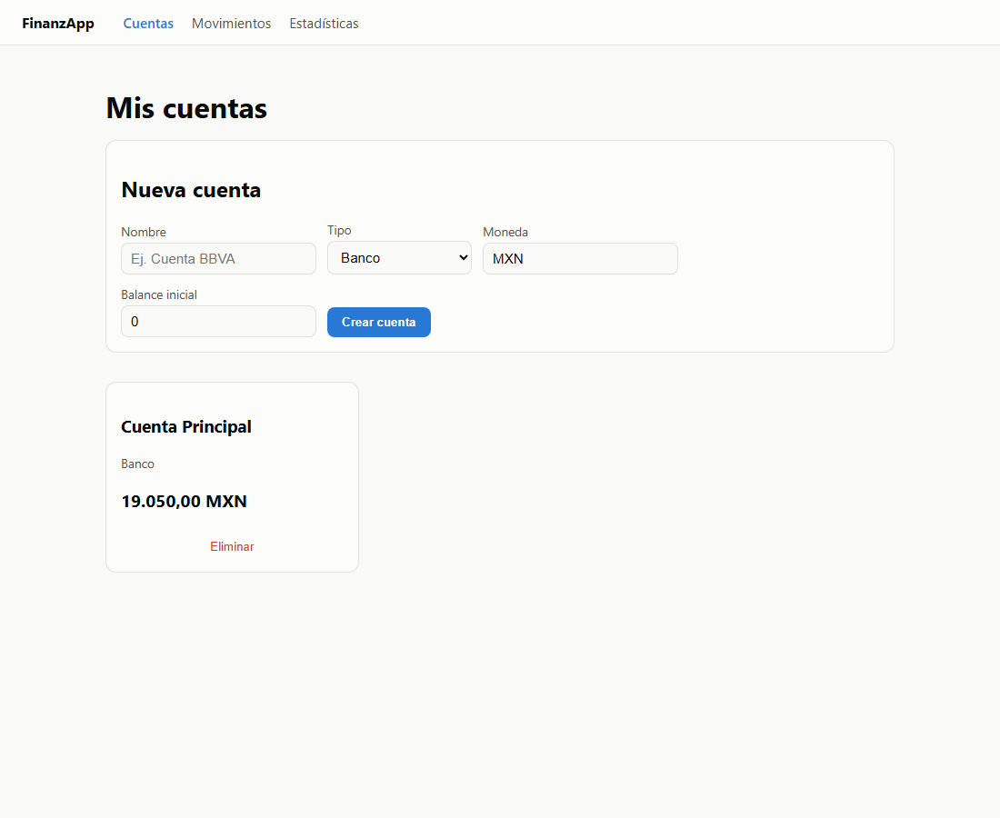
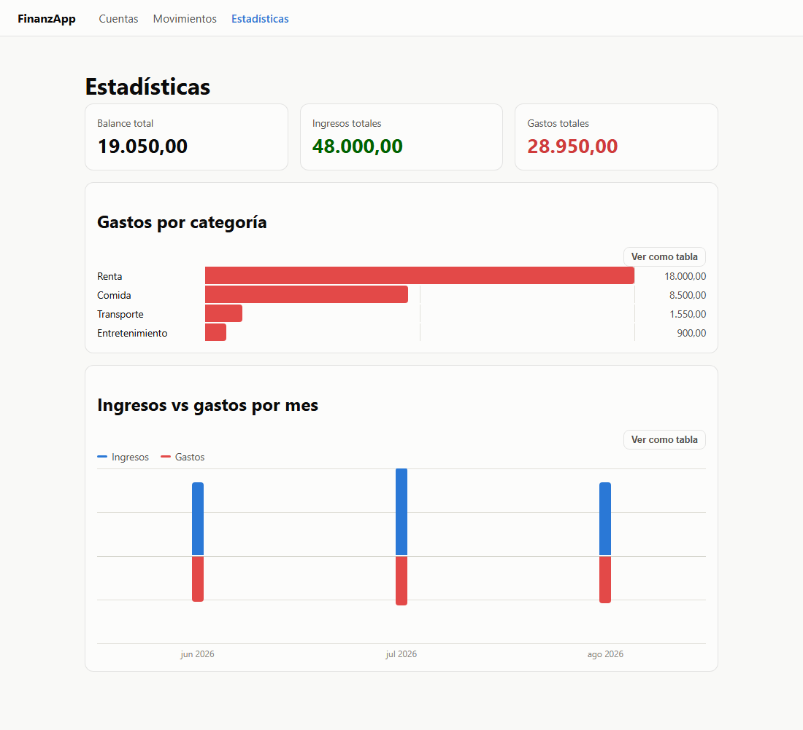

# FinanzApp

Aplicación web de finanzas personales full-stack: registro de cuentas, categorización de ingresos/gastos, y estadísticas visuales — con autenticación multiusuario, cada quien ve solo sus propios datos.


## Capturas

| Cuentas | Estadísticas |
|---|---|
|  |  |

## Stack

**Backend:** Python · FastAPI · SQLAlchemy 2.0 · Pydantic · PostgreSQL · Alembic · JWT (PyJWT + bcrypt)
**Frontend:** React 19 · TypeScript · Vite · React Router
**Infra:** Docker (Postgres vía `docker-compose`)

## Funcionalidades

- **Autenticación:** registro/login con JWT, cada usuario ve únicamente sus propias cuentas, categorías y movimientos.
- **Cuentas:** múltiples cuentas (banco, efectivo, tarjeta, ahorros) con balance que se actualiza automáticamente según sus movimientos.
- **Categorías:** separadas por tipo — gastos sin límite, ingresos limitados a 3 (la mayoría de personas solo tienen sueldo y quizá un ingreso extra).
- **Movimientos:** vista global de todos los ingresos/gastos de todas las cuentas, con filtros.
- **Estadísticas:** gastos por categoría (barras) e ingresos vs. gastos por mes (gráfico divergente), con vista de tabla alternativa.

## Arquitectura

```
finanzApp/
├── app/
│   ├── api/v1/endpoints/   # auth, accounts, categories, transactions, stats
│   ├── core/               # config y seguridad (hash de password, JWT)
│   ├── db/                 # engine, sesión, base declarativa
│   ├── models/              # SQLAlchemy: User, Account, Category, Transaction
│   └── schemas/             # Pydantic: validación de entrada/salida
├── alembic/                 # migraciones de base de datos
├── frontend/
│   └── src/
│       ├── api/              # cliente HTTP por recurso
│       ├── context/          # AuthContext (sesión)
│       ├── components/       # NavBar, ProtectedRoute, gráficas
│       └── pages/            # Login, Cuentas, Movimientos, Estadísticas, Categorías
├── docker-compose.yml        # Postgres local
└── requirements.txt
```

## Cómo correrlo localmente

**Requisitos:** Python 3.12+, Node 20+, Docker.

**1. Base de datos**
```bash
cp .env.example .env      # ajusta valores si hace falta
docker compose up -d
```

**2. Backend**
```bash
python -m venv venv
.\venv\Scripts\activate    # Windows (en Linux/Mac: source venv/bin/activate)
pip install -r requirements.txt
alembic upgrade head
uvicorn main:app --reload --port 8001
```

**3. Frontend**
```bash
cd frontend
cp .env.example .env
npm install
npm run dev
```

Abre `http://localhost:5173`. La documentación interactiva de la API está en `http://localhost:8001/docs`.

## Decisiones de diseño

- **Balance derivado, no editable directamente:** el balance de una cuenta solo cambia a través de sus movimientos (crear/editar/borrar), nunca se edita a mano — evita que se desincronice del historial.
- **La categoría define el tipo de movimiento:** en vez de que cada transacción tenga su propio campo "ingreso/gasto" independiente de su categoría, el tipo se deriva de la categoría elegida. Evita inconsistencias como asignar "Comida" a un ingreso por error.
- **Límite de categorías de ingreso:** una decisión de producto, no técnica — la mayoría de usuarios tiene 1-2 fuentes de ingreso fijas, así que forzar esa simplicidad evita categorías de ingreso desordenadas, mientras que los gastos (naturalmente más variados) no tienen límite.
